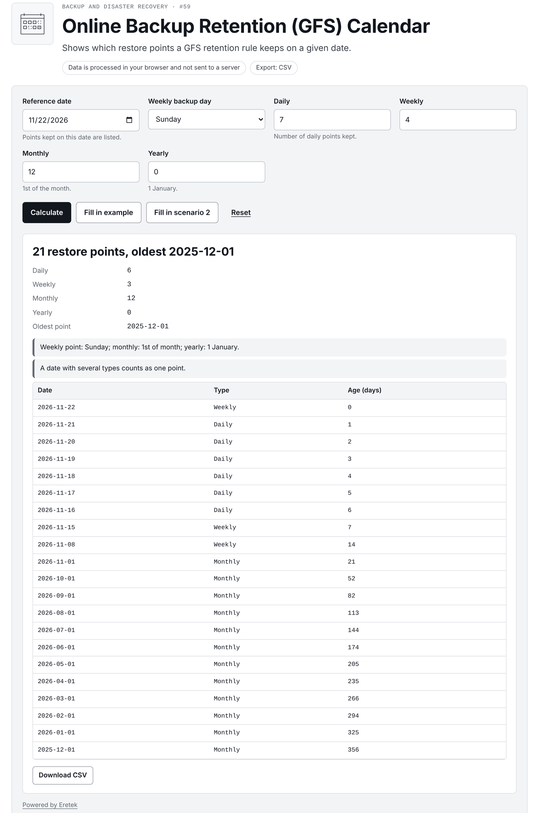

# Backup Retention (GFS) Calendar

From daily, weekly, monthly and yearly (GFS) retention settings, list which restore points exist on a given date, how many there are and the oldest point.

## Try it live

- [Türkçe](https://sistem.eretek.com/araclar/backup-retention-takvimi)
- [English](https://sistem.eretek.com/en/tools/backup-retention-calendar)
- [Deutsch](https://sistem.eretek.com/de/werkzeuge/backup-aufbewahrung-kalender)



## What it does

Shows which restore points a GFS retention rule keeps on a given date.

How many restore points does '7 daily, 4 weekly, 12 monthly' give, and what is the oldest date? Audits and 'we need last March's data' questions are answered by this calendar. The tool counts overlapping points (e.g. a Sunday backup that is both daily and weekly) once.

## Where it helps

Size the space with the Backup Repository and Immutable tools; remember monthly/yearly points are full backups.

## How to use it

1. Choose the reference date (today or audit date) and the weekday of the weekly backup.
2. Enter daily, weekly, monthly and yearly counts; press Calculate.
3. Download the points as CSV.

### Fields

| Field | Description |
|---|---|
| Reference date | Points kept on this date are listed. |
| Weekly backup day |  |
| Daily | Number of daily points kept. |
| Weekly |  |
| Monthly | 1st of the month. |
| Yearly | 1 January. |

## Example input

Press **Fill in example** in the tool to load this input.

| Input | Value |
|---|---|
| Reference date | `2026-11-22` |
| Weekly backup day | `Sunday` |
| Daily | `7` |
| Weekly | `4` |
| Monthly | `12` |

**Expected result:** On 22 November 2026: 21 points — 6 daily, 3 weekly (22, 15, 8 Nov), 12 monthly (1 Nov counts as monthly); oldest 1 December 2025.

## Method and assumptions

Daily: N days back from the reference. Weekly: the chosen weekday, N weeks back. Monthly: the 1st, N months. Yearly: 1 January, N years. A date in several types is shown with the longest-kept type and counted once.

## Limits and common mistakes

- Backup products offer options like 'last day of month/first Monday'; this tool uses the 1st of the month and 1 January.

## Run it locally

The tool is plain HTML, CSS and JavaScript with no build step and no dependencies.

```bash
git clone https://github.com/eretek/backup-retention-calendar.git
cd backup-retention-calendar
node scripts/serve.js        # or: python3 -m http.server 8080
```

Open <http://127.0.0.1:8080/>. Add `?lang=tr` or `?lang=de` for Turkish or German; without it the page follows the browser language and falls back to English. You can also open `index.html` directly from disk.

Run the tests (Node.js 18 or later):

```bash
node test/run.js    # or: npm test
```

The tests run the tool's own fixtures and the worked examples in all three languages without a browser.

## How it works

All processing happens in your browser. The tool makes no network requests, uses no cookies or browser storage, and does not upload files you select.

No server-side component is needed. The version on the Eretek website renders the same page through a private WordPress plugin; that plugin only produces the page markup and is not part of this repository.

| Path | Purpose |
|---|---|
| `index.html` | Page shell |
| `src/app.js` | Builds the page in Turkish, English or German from `src/data.js` |
| `src/data.js` | Field definitions, examples and all texts in three languages |
| `src/core.js` | Shared runtime: validation, number formats, result rendering, CSV/ICS export |
| `src/tool.js` | The calculation or analysis for this tool |
| `docs/screenshot.png` | Screenshot used in this README |
| `src/tools.css`, `src/page.css` | Styles |
| `test/run.js`, `test/cases.json` | Headless tests |

## License and attribution

This tool is released under the [Eretek Website Attribution License](LICENSE). You may use, modify and redistribute it, including commercially. If you make it available on a website or web application, show a visible, clickable credit linking to https://eretek.com/ on every page where the tool is available, for example:

```html
<a href="https://eretek.com/">Powered by Eretek</a>
```

You may add `rel="nofollow"` to the link. Keep the copyright notice and license text in copies and redistributions.
